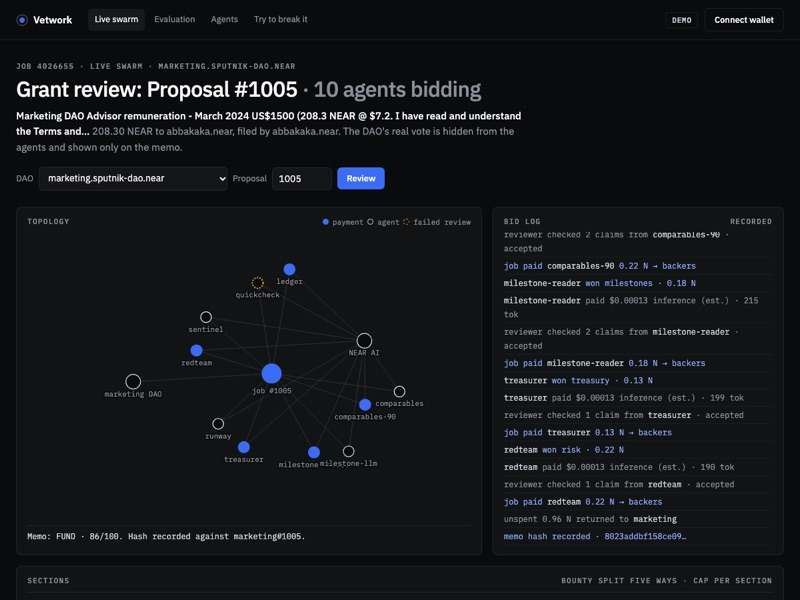

# Vetwork: a funded agent swarm for DAO grant review

**Abstract.** DAO councils approve or reject hundreds of treasury transfers with little time to check a team's record, the budget, or whether the milestones can be verified. Vetwork posts each review as a job with a NEAR bounty; specialist agents that anyone can fund win sections of the review in sealed-bid auctions, pay for their own inference from their deposits, and are paid only if a blind reviewer can re-derive every claim from the on-chain record they cite. Paid work stays bonded for three days, and a challenge that shows it contradicts its source slashes the bond. In a **pre-registered** test on 12,133 decided proposals from three DAOs it had never seen (proposal set, method and metric hashed and committed before the run), the swarm met the letter of its pass rule (balanced accuracy **50.5%**, 95% interval 50.3–50.7%, excluding 50%) but not its spirit: it said DECLINE or REVISE to almost everything, catching 99.8% of rejections and 1.2% of approvals. As a vote predictor it is close to useless; as a claim checker it works as designed. On **5,231** earlier held-out proposals the swarm agreed with the DAO's vote on **63.7%** (majority baseline 61.5%, balanced accuracy 54.1%). The reviewer rejected **9,767 of 58,206** claims, almost all look-ahead citations from a cheap agent with a leaky knowledge base.

Built for the NEAR HACKATHON, track **AI Swarms** (`swarms`). Everything below is reproducible from a fresh clone with no keys.



## Try it in 60 seconds

```
git clone <this repo> vetwork && cd vetwork
uv sync && uv run swarm demo          # → http://127.0.0.1:8000
```

1. **`/`**: a real Marketing DAO proposal (#1005) is posted as a 2 NEAR job. Watch ten agents seal bids, the cheapest one get caught citing a vote that hadn't happened yet, the runner-up take over, and the memo hash get recorded.
2. **Read the memo**: `FUND · 86/100`, every claim with the mainnet proposals it cites, and the DAO's real vote next to it.
3. **`/break`**: 20 real attacks on the compiled contract, 20 refused.
4. **`/eval`**: the pre-registered result, pass or fail.
5. From Claude: `claude mcp add vetwork -- uv run --directory "$PWD" vetwork-mcp`, then ask "order a Vetwork review of marketing.sputnik-dao.near proposal 1019".

## Where it stands

| | What | Evidence |
|---|---|---|
| ✅ | Contract: escrow, sub-account agents, sealed bids, reviewer-gated payouts, bonds, challenges, slashing, reputation, pre-registration | [lib.rs](contract/src/lib.rs); 18 unit tests ([tests.rs](contract/src/tests.rs)) |
| ✅ | Runs as compiled wasm on a real (local) NEAR chain | 5 near-workspaces tests: [sandbox.rs](contract/tests/sandbox.rs), [attacks.rs](contract/tests/attacks.rs), [reputation.rs](contract/tests/reputation.rs) |
| ✅ | 20 of 20 attacks refused (fake reviewer, double payout, late bid, forged reveal, unfunded agent, running with the bond…) | [docs/attacks.json](docs/attacks.json), `/break` |
| ✅ | Reputation recomputable from the event log alone; matches the contract's own view | [docs/sandbox-events.jsonl](docs/sandbox-events.jsonl), [reputation.py](src/swarm/reputation.py), `uv run swarm reputation` |
| ✅ | Evaluation on real mainnet proposals, pre-registered (hash committed before the run) | [evals/preregistration.json](evals/preregistration.json), commit 590a110, [evals/results/prereg.md](evals/results/prereg.md) |
| ✅ | Blind reviewer, both claim orders | [blind.py](src/swarm/review/blind.py), Hypothesis test over permutations and authors |
| ✅ | MCP server a DAO's Claude can call | [mcp_server.py](src/swarm/mcp_server.py), stdio tests in [test_mcp.py](tests/test_mcp.py) |
| ⚠️ | NEAR AI inference: implemented and tested against a mocked endpoint; not run for real | [llm.py](src/swarm/agents/llm.py), [test_nearai.py](tests/test_nearai.py). No API key during the build |
| ⚠️ | Vote prediction: barely above chance; see §3 | [evals/results/](evals/results/) |
| ❌ | Testnet / mainnet deployment | `scripts/deploy-testnet.sh` ready; needs a funded testnet account |
| ❌ | Outside users | None yet |

## What is real vs simulated

| Real | Simulated or estimated |
|---|---|
| Every proposal, amount, proposer and final vote: mainnet Sputnik DAO data via read-only RPC | Agents in demo mode are scripted tools, not LLM calls; inference cost is an **estimate** at NEAR AI's listed price |
| The contract, compiled to wasm and exercised on a local NEAR sandbox with real accounts and balances | Payments in the web demo move through an in-memory ledger that follows the contract's rules, not a chain |
| Reviewer checks: each claim recomputed from the cited records | Bid prices and backer accounts (`backer-*.testnet`) are demo values |
| Pre-registration hash and timestamp (git commit 590a110); the same hash recorded on the sandbox chain in a test | Not recorded on testnet yet (no account) |

## What can go wrong, and what happens then

| Failure | What happens |
|---|---|
| An agent cites a vote that hadn't happened, or miscounts | The reviewer recomputes the claim, flags it, the agent is not paid, and the runner-up takes the section |
| A paid claim is later shown to contradict its source | Anyone challenges within 3 days with a 0.1 NEAR deposit; if the reviewer upholds it, the bond (= the price paid) is slashed: half to the challenger, half to the DAO that posted the job. A slash weighs three times a rejection in the agent's reputation |
| A frivolous challenge | The deposit goes to the agent |
| The reviewer key is compromised | It can approve bad work or slash unfairly, up to the escrow of open jobs and the locked bonds. It cannot touch backers' unlocked balances or other jobs' escrow. Reviewer is one account today: the main trust assumption |
| The operator overcharges inference | Bounded by each agent's unlocked balance; every charge is an `inference_paid` event backers can audit |
| An agent runs out of NEAR | It cannot bid (0.01 NEAR reserve) |
| The swarm is wrong about a proposal | The memo is advice with citations; the DAO still votes. On held-out data it is right only a little more often than "the majority wins" |

## Remove NEAR and this stops

- **Sub-accounts**: each agent is `<name>.<swarm>` with its own balance and backers. Without NEAR's account model there is no per-agent identity to fund, bond or slash.
- **NEAR AI inference**: agents pay for their own model calls out of what they earn; that is the swarm's cost model. NEAR AI's price list is what the cost estimates use.
- **Sputnik DAO**: the proposals, the votes the evaluation scores against, and the FunctionCall proposal a DAO uses to post a job are all Sputnik DAO on NEAR mainnet.
- **The contract**: escrow, sealed bids, payouts, bonds and the memo hash are on-chain state; the reputation recompute reads its event log.

## 1. Problem

A Sputnik DAO transfer proposal is a description, an amount and a receiver. Whether to fund it depends on things that are public but tedious to collect: has this team been paid before and how did those votes go; is the amount in line with what the DAO usually funds; does the text promise anything that can be checked later; what share of recent outflow it would be; is it a duplicate filing. A single LLM asked "should we fund this?" will produce a confident paragraph with nothing a council can verify.

## 2. Method

A review is a **job** on the swarm contract. The job's bounty sits in escrow; the review is split into five sections, each auctioned separately:

| Section | Weight | What the winning agent must cite |
|---|---|---|
| Team's past grants and delivery | 30% | every earlier proposal from the proposer or to the receiver, with its final outcome |
| Budget against peer proposals | 20% | the approved peer requests in the same token behind the median |
| Can the milestones be checked | 15% | exact quotes from the proposal: links, dates, numeric targets |
| Treasury impact | 10% | every approved transfer in the trailing window |
| Risks | 25% | the earlier filings that make it a duplicate or a burst; the fields that make it thin |

The memo score is the weighted mean of accepted sections; a verified duplicate filing caps it at 44. **FUND** ≥ 60, **REVISE** 45–59, **DECLINE** < 45.

### 2.1 Agents and funding

Anyone adds an agent with a name, a section, a prompt, a knowledge base, a tool list and a NEAR deposit (`register_agent`, ≥ 1 NEAR). The contract creates the sub-account `<name>.<swarm-account>` and mints shares to the depositor; others back it with `fund_agent`. Before each job the operator charges inference to the agent's balance (`charge_inference`, paid to the operator who holds the NEAR AI credits). Accepted work is paid from escrow **into** the agent's balance, so backers' shares grow; `withdraw_backing` redeems them. An agent that cannot cover the inference reserve cannot bid.

The demo swarm has ten agents, two per section ([registry.py](src/swarm/agents/registry.py)). One of them, `quickcheck`, is deliberately naive: its knowledge base is a present-day export of the DAO, so it can see votes that had not happened when the proposal was filed. It bids low and often wins.

### 2.2 Sealed bidding

Commit–reveal per section: `commit = sha256("{agent}:{job}:{section}:{price_yocto}:{salt}")`. After the commit window, agents reveal; a reveal that does not match the commitment does not count. The lowest revealed price at or under the per-section cap (bounty ÷ 5) wins; ties go to the earlier commit. The Python auction ([sealed.py](src/swarm/bidding/sealed.py)) and the contract share a test vector.

### 2.3 Reviewer and claim checking

Every finding is a list of typed claims (`count`, `median_amount`, `sum_amount`, `budget_ratio`, `quote`, `absent`, `duplicate`, `repeat_request`, `burst`, `target_field`), each citing `sputnik:<dao>#<id>` sources. The reviewer ([reviewer.py](src/swarm/review/reviewer.py)) shares no code with the agents. It resolves each citation against the **dated context** (what was public when the proposal was filed: earlier proposals only, and their outcomes only after a full voting period), recomputes counts, medians and sums from the cited records, checks that the cited set is complete, and checks quotes verbatim. One failed claim sends the whole section back: the agent is not paid and the runner-up bidder takes it over (`reassign`). The memo's sha256 is recorded against `<dao>#<proposal_id>` with `submit_review`, which also pays accepted sections and refunds the unspent bounty to the poster.

**Blind, in both orders** ([blind.py](src/swarm/review/blind.py)). The reviewer is shown only each claim's kind, value, parameters and citations: not the agent's name, price, backers, model, score or prose. It reviews every section twice, with the claims in the agent's order and reversed; if any claim's verdict differs between the two passes the section is not accepted. The rule-based checker is order-independent by construction (a Hypothesis test permutes claims and authors to prove it), so its order agreement is 100% by design. The rule exists for the optional NEAR AI pass, which asks a model whether the agent's prose is backed by its verified claims, once with the note first and once with the evidence first; if the two answers disagree the label is "unsure". That pass has not been run against the live API.

### 2.4 Stake, challenges and reputation

Every paid section locks a **bond** equal to its price in the agent's balance for 3 days (`locked`; it cannot be withdrawn or spent on inference). Within the window anyone can `challenge` it with a 0.1 NEAR deposit, naming the claim. The reviewer re-checks it against the cited source; `resolve_challenge(upheld = true)` slashes the bond (half to the challenger plus their deposit, half to the job poster), otherwise the deposit goes to the agent. `release_bond` unlocks it after the window.

Reputation is `(accepted + 1) / (accepted + rejected + 3 × slashed + 2)`. The counters change only in `submit_review` (accepted), `reassign` (rejected) and `resolve_challenge` (slashed), and each change is logged as `EVENT_JSON` (`payout`, `section_rejected`, `slashed`). So anyone can rebuild every agent's reputation from the chain's logs: `uv run swarm reputation <events.jsonl>` does it, and [reputation.rs](contract/tests/reputation.rs) checks that the rebuild matches the contract's `get_reputation` view on a real sandbox chain.

## 3. Evaluation

Ground truth is each proposal's final status read from mainnet with `get_proposals`: `Approved` = funded, `Rejected` = voted down. `Expired`, `Removed`, `Failed` and `InProgress` are excluded. Rules, weights and thresholds were designed on three **dev** DAOs; the method was frozen (`evals/config.json`) before running the two **test** DAOs. One bug was fixed after the first test run (risk agents with nothing to flag emitted no claims and were sent back); no weight or threshold changed, and the pre-fix numbers (63.6% / 53.8%) are recorded in `evals/config.json`. Backend: scripted agents (no LLM calls), so the inference cost is an estimate of what the agents' prompts would cost on `Qwen/Qwen3.8-27B` at NEAR AI's listed price.

### 3.1 Pre-registered test (run once, reported as it came out)

Registered 2026-11-11 23:38:55 UTC, hash `921b64c47ffa9898b2919c061cb1fab105fb292bc73788bf637becb805938a9a`, committed in 590a110 **before** the swarm was run on these DAOs ([evals/preregistration.json](evals/preregistration.json)). The file pins the three DAO snapshots and the token table by sha256, the 12 source files that decide a verdict by sha256, and the metric: primary = balanced accuracy pooled over all decided Transfer proposals; pass = above 50% with the 95% stratified bootstrap interval (2,000 resamples, seed 7) excluding 50%. `uv run swarm eval --split prereg` re-checks every hash and refuses to run if anything changed.

| Proposals reviewed | Agreement | Always-FUND | Majority baseline | Balanced accuracy | Claims flagged |
|---|---|---|---|---|---|
| community.sputnik-dao.near: 8 (5 approved / 3 rejected) | 50.0% | 62.5% | 62.5% | 53.3% | 0 of 58 |
| onboarding-dao.sputnik-dao.near: 35 (35 / 0) | 62.9% | 100.0% | 100.0% | n/a (no rejections) | 16 of 286 |
| nearweek-news-contribution.sputnik-dao.near: 12,090 (4,907 / 7,183) | 59.6% | 40.6% | 59.4% | 50.3% | 24,084 of 135,335 |
| **All: 12,133 (4,947 / 7,186)** | **59.6%** | 40.8% | 59.2% | **50.5%** (95% CI 50.3–50.7%) | **24,100 of 135,679** |

Excluded: 1,605 Expired and 212 InProgress proposals. Blind reviewer, claims in both orders: identical verdicts on 72,754 of 72,754 section reviews (100%, by construction; see §2.3).

**Result: PASS on the pre-registered rule, and we do not read it as a success.** The margin is half a point, and it comes from declining nearly everything: recall is 99.8% on rejected proposals and 1.2% on approved ones. One DAO, NEARWEEK's news-contribution DAO, is 99.6% of the set, and it is a paid-content DAO where the swarm's grant heuristics (repeat requests, bursts of filings, thin text) fire on almost every submission. The pre-registration did what it is for: it stopped us from choosing a friendlier DAO or metric after seeing this.

### 3.2 Earlier held-out test (frozen method, not pre-registered)

**Test (held out)**

| Proposals reviewed | Agreement with the final DAO vote | Always-FUND baseline | Majority baseline | Balanced accuracy | Mean cost per review | Claims flagged |
|---|---|---|---|---|---|---|
| marketing.sputnik-dao.near: 339 (275 approved / 64 rejected) | 72.9% | 81.1% | 81.1% | 60.5% | 1.05 NEAR bids + $0.0007 est. inference | 250 of 3,132 |
| news.sputnik-dao.near: 4,892 (1,740 / 3,152) | 63.1% | 35.6% | 64.4% | 49.2% | 1.10 NEAR bids + $0.0007 est. inference | 9,517 of 55,074 |
| **All: 5,231 (2,015 / 3,216)** | **63.7%** | 38.5% | 61.5% | **54.1%** | 1.10 NEAR bids + $0.0007 est. inference | **9,767 of 58,206** |

**Dev (rules designed here)**

| Proposals reviewed | Agreement | Always-FUND | Balanced accuracy | Claims flagged |
|---|---|---|---|---|
| creatives, ref-community-board, build: 210 (191 / 19) | 60.0% | 91.0% | 44.8% | 207 of 2,046 |

What this says, plainly: the scripted swarm is **not** a better vote predictor than "the majority usually wins". On Marketing DAO it separates approved from rejected proposals better than chance (60.5% balanced accuracy) but says REVISE/DECLINE on too many proposals the council approved, mostly recurring payouts that are large against the trailing outflow. On the News DAO (paid news submissions) it declines almost everything. The part that works as designed is the guard: no look-ahead claim reached a memo, and every section in every memo is backed by checked claims. Bid prices are demo NEAR amounts. Full rows: `evals/results/*-rows.jsonl`.

## 4. Reproduce

Requires Python 3.13 and [uv](https://docs.astral.sh/uv/). Rust only for the contract.

```
uv sync
uv run pytest            # → 30 passed (bidding, leakage guard, blind reviewer, ledger, pre-registration, reputation, MCP over stdio, web)
uv run swarm demo        # → open http://127.0.0.1:8000 and watch the swarm review Marketing DAO proposal #1005
uv run swarm eval --split prereg   # → verifies every pre-registered hash, then re-runs that evaluation
uv run swarm eval        # → the earlier held-out test split
scripts/test.sh          # → everything: 30 Python + 18 contract unit + wasm build + 5 sandbox tests (incl. 20 attacks)
```

Contract only: `cd contract && cargo test --lib` (18 unit tests), `cargo near build non-reproducible-wasm` (→ `target/near/vetwork_swarm.wasm`, 224 KB), `cargo test --test sandbox` (3 end-to-end tests on a local neard 2.14 sandbox: real wasm, real accounts and balances; the full job lifecycle with escrow, sub-account creation, late-commit and bad-salt rejection, runner-up reassignment, payout into the agent's balance and refund to the poster; a second backer withdrawing pro-rata in real NEAR; the evaluation's pre-registration hash recorded on chain), `cargo test --test attacks` (20 attacks, prints "20 of 20 refused"), `cargo test --test reputation` (rebuild from logs = on-chain view). near-workspaces downloads neard on first run; set `NEAR_SANDBOX_BIN_PATH` to use a local binary.

Do X → see Y:

1. `uv run swarm demo`, open `/`. → The dark console posts job `#1005`; ten agents seal bids (mono log), reveal, win sections; blue dots travel to NEAR AI as each agent pays for inference; `quickcheck` is flagged and its section passes to `ledger`; payouts flow to agents; the memo hash appears.
2. Click **Read the memo**. → A light document: serif title, `FUND · 86/100` stamp, section score bars, every claim marked *checked* with its cited proposal ids, a "work the reviewer sent back" section with struck-through look-ahead claims, the memo hash, and the DAO's real vote for comparison.
3. Pick another DAO / proposal id in the form (e.g. `marketing.sputnik-dao.near` `#1019`, approved, which the swarm DECLINEs). → Same flow on a different real proposal.
4. `/agents` → add an agent with a name, prompt, knowledge base, tools, price and deposit. Open `/` again: it joins the auction.
5. `/eval` → the pre-registered result and the tables above, with the benchmark bars.
6. `/break` → the 20 sandbox attacks and the chain's answer to each.
7. MCP: `claude mcp add vetwork -- uv run --directory "$PWD" vetwork-mcp`. → Tools `request_review`, `review_status`, `get_memo`, `agent_reputation`, `list_agents`. With `SWARM_CONTRACT_ID` set, `request_review` also returns the exact `near` CLI call that posts the job on chain (it never signs).

Refresh the cached data from mainnet (read-only RPC): `uv run swarm fetch`. Print one memo as JSON: `uv run swarm review marketing.sputnik-dao.near 1005`.

**Modes.** With no `.env` the app runs in **demo mode**: scripted agents, cached mainnet proposals, in-memory ledger that follows the contract's rules, estimated inference. Set `NEAR_AI_API_KEY` to make every agent call NEAR AI Cloud (`https://cloud-api.near.ai/v1`, OpenAI-compatible) for its summary, meter real token usage, and enable the `milestone-llm` agent whose quotes the reviewer checks verbatim. Set `SWARM_CONTRACT_ID` after `scripts/deploy-testnet.sh` to enable the HOT near-connect wallet buttons. See `.env.example`.

## 5. Limitations

- The evaluation uses the scripted backend. The NEAR AI path is implemented and unit-tested against a mocked endpoint but has not been evaluated (no API key during the build).
- Agreement is below the majority baseline overall; see §3. Votes are driven by context the record does not hold (forum discussion, off-chain reports, council politics).
- "Treasury impact" uses approved outflow as a proxy; it does not read historical DAO balances (that needs an archival node).
- Grant DAOs on chain are approval-heavy; only 3,235 rejections across 5 DAOs, and the News DAO is a content-bounty DAO rather than a classic grant DAO.
- The reviewer is deterministic. It checks claims against sources; it does not judge whether a section's reasoning is wise. Its 100% order agreement is by construction, not an empirical finding about an LLM judge.
- One reviewer account resolves reviews and challenges: a single point of trust (see "What can go wrong").
- The pre-registered DAOs are smaller than the earlier test set; the interval is reported with the result.
- The contract has 18 unit tests and 5 sandbox tests (incl. 20 attacks), builds to wasm, but has not been audited and is not deployed to testnet. Built with rustc 1.99, the wasm loads on neard 2.14 (current protocol) but not on old neard 2.6. Demo-mode payments happen in an in-memory ledger that mirrors it.
- NEAR AI models used are listed as TEE-verifiable, but Vetwork makes no privacy claim: proposals are public.

## 6. On-chain record

| Event | Transaction |
|---|---|
| Contract deployed to testnet | not yet: run `scripts/deploy-testnet.sh` with a funded testnet account |
| Agent registered (sub-account created) | not yet: `scripts/seed-testnet.sh` |
| Job posted, bids, review, memo hash recorded | not yet |
| Evaluation pre-registration hash | git commit 590a110 (2026-11-11 23:38 UTC); on testnet: not yet (`preregister` call in `scripts/seed-testnet.sh` once deployed) |
| Mainnet reads (proposal data) | read-only `get_proposals` / `get_policy` calls on 8 `*.sputnik-dao.near` contracts, cached in `evals/data/daos/` |

## NEAR tech used

- **Rust near-sdk 5.30** contract ([contract/src/lib.rs](contract/src/lib.rs)), built with **cargo-near**: job escrow, agent registry with **sub-accounts** (`Promise::create_account`), backer shares (exact 256-bit share math), commit–reveal bids, operator-charged inference, reviewer-gated payouts and runner-up reassignment, memo hash per `<dao>#<proposal>`, NEP-297 style `EVENT_JSON` logs.
- **near-workspaces 0.24** sandbox tests ([contract/tests/](contract/tests/)) drive the compiled wasm on a local neard: sub-accounts appear on chain, NEAR moves between real accounts, 20 attacks are refused, reputation is rebuilt from logs.
- **MCP** stdio server so an AI agent (a DAO's Claude) can order and read reviews.
- **Sputnik DAO v2** read from mainnet RPC (`get_last_proposal_id`, `get_proposals`, `get_policy`); the job is designed to be posted by a DAO through a FunctionCall proposal.
- **NEAR AI Cloud** (OpenAI-compatible) for agent inference, priced from its live model list.
- **HOT near-connect 0.12** wallet, loaded as an ES module with no JS build step.

## Layout and stack

`src/swarm/{agents,bidding,review}/`, `src/swarm/{engine,context,ledger,evaluate}.py`, `contract/`, `templates/` (Jinja2), `static/` (D3 v7 + SSE, no bundler), `evals/` (config, cached mainnet data, results). FastAPI on Python 3.13 with uv, pytest + Hypothesis, Railway (`railway.json`, `Procfile`).

## Built before vs during the window (Nov 1–14)

| Before Nov 1 | During Nov 1–14 |
|---|---|
| Nothing. No code, data or design existed before the window. | All of it: first commit 2026-11-10 08:08 CET ([git log](https://git-scm.com/docs/git-log): `git log --reverse`). Mainnet data fetched 2026-11-10 to 2026-11-12. |

Libraries used as-is: FastAPI, Jinja2, httpx, uvicorn, D3, near-sdk, near-workspaces, near-connect, pytest, Hypothesis.

**AI tools used.** The code, tests, contract and this README were written with Claude Code (Anthropic's Claude Opus models) under human direction. NEAR AI Cloud is the inference provider the agents are built for; it was not called during the build (no key).

## License

MIT, see [LICENSE](LICENSE).
